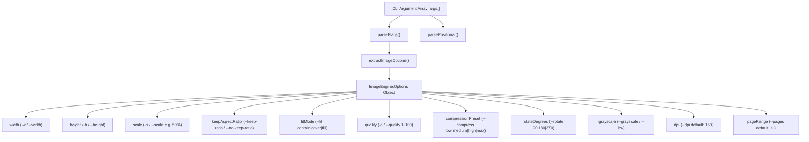
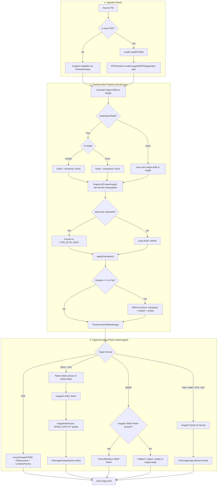
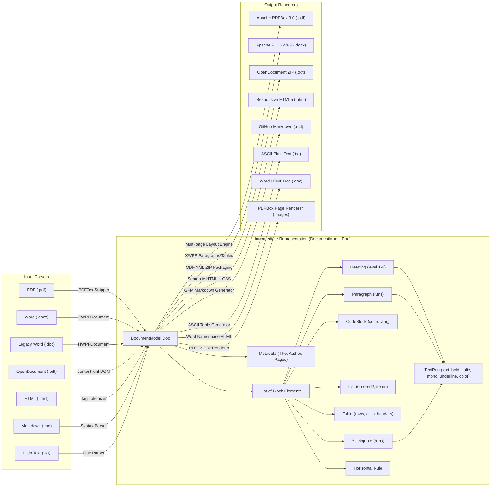
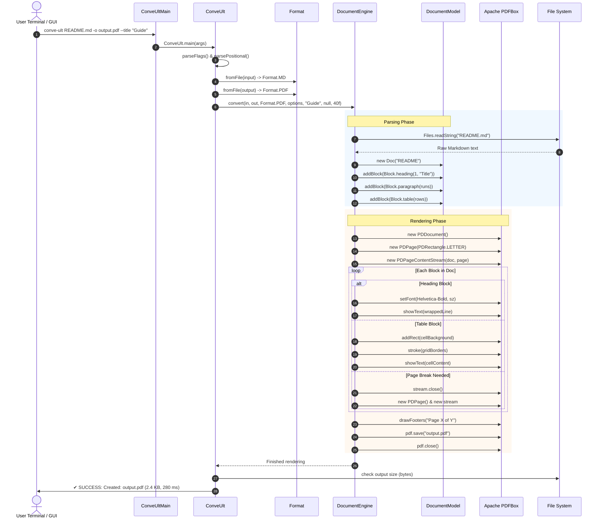
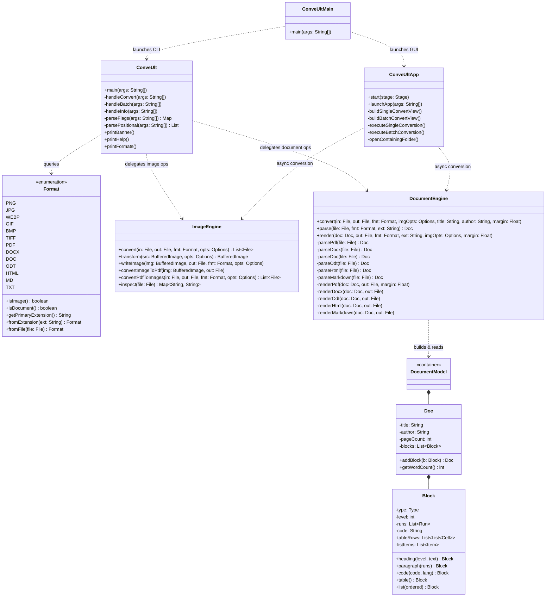

# conve-ult — Technical Code & Architecture Documentation 📘
### *Comprehensive Architecture, Flowcharts, Internal Engines & Developer Guide*

---

## 📑 Table of Contents
1. [High-Level Architecture & Design Principles](#1-high-level-architecture--design-principles)
2. [End-to-End Execution Flowchart](#2-end-to-end-execution-flowchart)
3. [Command Routing & CLI Lifecycle](#3-command-routing--cli-lifecycle)
4. [Image Pipeline Architecture & Transformation Flow](#4-image-pipeline-architecture--transformation-flow)
5. [Document Pipeline & The $N \times M$ Intermediate Model](#5-document-pipeline--the-n--m-intermediate-model)
6. [Component Interaction Sequence Diagram](#6-component-interaction-sequence-diagram)
7. [Class & Object Structure Diagram](#7-class--object-structure-diagram)
8. [Step-by-Step Code Execution Traces](#8-step-by-step-code-execution-traces)
9. [Project Structure](#9-project-structure)
10. [Core Module Walkthrough](#10-core-module-walkthrough)
    - [10.1 Format Registry (`Format.java`)](#101-format-registry-formatjava)
    - [10.2 Unified Document Model (`DocumentModel.java`)](#102-unified-document-model-documentmodeljava)
    - [10.3 Image Processing Engine (`ImageEngine.java`)](#103-image-processing-engine-imageenginejava)
    - [10.4 Document Processing Engine (`DocumentEngine.java`)](#104-document-processing-engine-documentenginejava)
    - [10.5 CLI Application Controller (`ConveUlt.java`)](#105-cli-application-controller-conveultjava)
    - [10.6 JavaFX GUI Desktop Application (`ConveUltApp.java` & `DarkTheme.java`)](#106-javafx-gui-desktop-application)
11. [Deep Dives into Underlying Technologies](#11-deep-dives-into-underlying-technologies)
    - [Apache PDFBox 3.0.1](#apache-pdfbox-301)
    - [Apache POI 5.2.5 (OOXML & Scratchpad)](#apache-poi-525-ooxml--scratchpad)
    - [TwelveMonkeys ImageIO](#twelvemonkeys-imageio)
12. [Resilience, Fallbacks & Safety Mechanics](#12-resilience-fallbacks--safety-mechanics)
13. [Developer Guide: Extending conve-ult](#13-developer-guide-extending-conve-ult)
14. [Cross-Platform Compilation & Execution Architecture](#14-cross-platform-compilation--execution-architecture)

---

## 1. High-Level Architecture & Design Principles

### 1.1 The $N \times M$ Matrix Problem
Traditional converters often write separate translation logic for each format pair ($A \to B$). Supporting $N$ input formats and $M$ output formats typically requires $N \times M$ individual translators, which leads to exponential code growth, duplication, and fragility.

**`conve-ult` solves this using an Intermediate Representation (IR) Pattern:**

```
                  ┌───────────────┐
                  │ Input Format  │ (PDF, DOCX, DOC, ODT, HTML, MD, TXT, IMG)
                  └───────┬───────┘
                          │  Parse
                          ▼
            ┌───────────────────────────┐
            │   Unified DocumentModel   │ (Doc AST: Headings, Runs, Tables, Lists, Code)
            └─────────────┬─────────────┘
                          │  Render
                          ▼
                  ┌───────────────┐
                  │ Output Format │ (PDF, DOCX, DOC, ODT, HTML, MD, TXT, IMG)
                  └───────────────┘
```

With this architecture:
- Adding a new input parser immediately makes that format convertible to **all** target formats.
- Adding a new output renderer immediately allows **all** input formats to target it.
- Total complexity is reduced from $O(N \times M)$ to $O(N + M)$.

### 1.2 Zero-Daemon, Native JVM Execution
Many office conversion tools rely on running background LibreOffice / OpenOffice headless daemons or headless Chromium instances. While feature-rich, these daemons:
- Consume hundreds of megabytes of background memory.
- Introduce IPC timeouts, zombie processes, and daemon crashes.
- Often fail in containerized or locked-down environments due to missing D-Bus services.

`conve-ult` runs **100% inside the Java Virtual Machine (JVM)** using robust libraries:
- **Apache POI 5.2.5** for Microsoft Office formats (`.docx`, `.doc`).
- **Apache PDFBox 3.0.1** for PDF rendering, layout, and generation.
- **TwelveMonkeys ImageIO 3.10.1** for WebP and modern image formats.
- **Standard Java XML & Zip APIs** for OpenDocument (`.odt`) packaging.

### 1.3 System Component Architecture

```
┌────────────────────────────────────────────────────────────────────────┐
│                              ConveUltMain                              │
│              Universal Dispatcher (GUI or CLI based on args)           │
└───────────────────┬────────────────────────────────┬───────────────────┘
                    │                                │
                    ▼                                ▼
       ┌────────────────────────┐      ┌────────────────────────┐
       │     ConveUltApp.java   │      │      ConveUlt.java     │
       │   JavaFX Dark Mode GUI │      │   Headless CLI Engine  │
       │  Drag & Drop • Batch   │      │ Terminal UI • Flags    │
       └────────────┬───────────┘      └────────────┬───────────┘
                    │                               │
                    └───────────────┬───────────────┘
                                    │
                    ┌───────────────┴───────────────┐
                    │                               │
                    ▼                               ▼
       ┌─────────────────────────┐      ┌─────────────────────────┐
       │     ImageEngine.java    │      │   DocumentEngine.java   │
       │  Scaling • Compression  │      │  Parsing & Rendering    │
       │  Aspect Ratio • Filters │      │  POI • PDFBox • ODF XML │
       │   PDF <-> Image Bridge  │      └────────────┬────────────┘
       └────────────┬────────────┘                   │
                    │                                ▼
                    │                   ┌─────────────────────────┐
                    │                   │   DocumentModel.java    │
                    │                   │ Intermediate AST Model  │
                    │                   │ Doc • Block • Run • Cell│
                    │                   └────────────┬────────────┘
                    ▼                                │
       ┌─────────────────────────────────────────────▼───────────┐
       │                       Format.java                       │
       │     Registry of Formats, Extensions, MIME & Kind        │
       └─────────────────────────────────────────────────────────┘
```

---

## 2. End-to-End Execution Flowchart

The following diagram illustrates what happens from the millisecond the user runs `conve-ult` in terminal until the converted file is saved and status is printed:

```mermaid
flowchart TD
    START(["User Command / Launcher"]) --> WRAPPER["bin/conve-ult or conve-ult.bat"]
    WRAPPER --> CHECK_JAR{"target/conve-ult.jar exists?"}
    CHECK_JAR -- No --> COMPILE["Run build script (build.sh / build.bat)"]
    COMPILE --> LAUNCH["Invoke JVM with Log Suppression"]
    CHECK_JAR -- Yes --> LAUNCH

    LAUNCH --> ENTRY["ConveUltMain.main(String[] args)"]
    ENTRY --> CHECK_MODE{"Explicit GUI flag or No Args with Desktop Display?"}
    CHECK_MODE -- Yes --> GUI_APP["ConveUltApp.launchApp() -> JavaFX UI"]
    CHECK_MODE -- No --> CLI_ENTRY["ConveUlt.main(args)"]

    CLI_ENTRY --> PARSE_ARGS["parseFlags() & parsePositional()"]
    PARSE_ARGS --> CMD_DISPATCH{"Command Mode?"}
    CMD_DISPATCH -- "--help / -h" --> HELP["printHelp() & Exit 0"]
    CMD_DISPATCH -- "--version / -V" --> VER["printVersion() & Exit 0"]
    CMD_DISPATCH -- "formats" --> FMT["printFormats() & Exit 0"]
    CMD_DISPATCH -- "info <file>" --> INFO["handleInfo() -> Inspect File Metadata"]
    CMD_DISPATCH -- "batch <dir>" --> BATCH["handleBatch() -> Iterate & Convert Folder"]
    CMD_DISPATCH -- "<input> [output]" --> CONVERT["handleConvert()"]

    CONVERT --> RESOLVE_OUT["Resolve Output Path & Target Format"]
    RESOLVE_OUT --> EXIST_CHECK{"Output Exists & no -f?"}
    EXIST_CHECK -- Yes --> WARN_EXIT["Warn and Exit 2"]
    EXIST_CHECK -- No --> OP_CHECK{"Is Image Operation?"}

    OP_CHECK -- Yes (Img->Img, Img->PDF, PDF->Img) --> IMG_FLOW["ImageEngine.convert(...)"]
    OP_CHECK -- No (Doc->Doc, Doc->Img) --> DOC_FLOW["DocumentEngine.convert(...)"]

    IMG_FLOW --> BENCHMARK["Calculate Elapsed Time & Size Delta"]
    DOC_FLOW --> BENCHMARK

    BENCHMARK --> SUCCESS["printSuccess() with Size % and Milliseconds"]
    SUCCESS --> DONE(["Process Complete (Exit 0)"])
```



---

## 3. Command Routing & CLI Lifecycle

Every CLI invocation passes through strict flag parsing, normalization, and option extraction:



---

## 4. Image Pipeline Architecture & Transformation Flow

The image conversion engine ([`ImageEngine.java`](file:///home/akon-s/Documents/Projects/vibecheck/src/main/java/com/conveult/ImageEngine.java)) processes raster images, vector pages, and multi-page PDFs:



---

## 5. Document Pipeline & The $N \times M$ Intermediate Model

The document conversion system ([`DocumentEngine.java`](file:///home/akon-s/Documents/Projects/vibecheck/src/main/java/com/conveult/DocumentEngine.java)) bridges arbitrary document formats through a structured Abstract Syntax Tree ([`DocumentModel.java`](file:///home/akon-s/Documents/Projects/vibecheck/src/main/java/com/conveult/DocumentModel.java)):



---

## 6. Component Interaction Sequence Diagram

This sequence diagram depicts the exact control flow during a document conversion (e.g., Markdown $\to$ PDF):



---

## 7. Class & Object Structure Diagram



---

## 8. Step-by-Step Code Execution Traces

### Trace 1: Converting an Image to Compressed WebP
```bash
conve-ult banner.png -o banner.webp --width 1200 --quality 80
```

1. **Launcher Invocation:**
   - `bin/conve-ult` (or `conve-ult.bat`) invokes `java -cp target/conve-ult.jar:... com.conveult.ConveUltMain banner.png -o banner.webp --width 1200 --quality 80`.
2. **Flag Parsing (`ConveUlt.parseFlags`):**
   - Populates `opts["output"] = "banner.webp"`, `opts["width"] = "1200"`, `opts["quality"] = "80"`.
   - `extractImageOptions()` creates `ImageEngine.Options` with `width = 1200`, `quality = 0.80f`, `keepAspectRatio = true`, `fitMode = "contain"`.
3. **Format Detection (`Format.fromFile`):**
   - `inFmt = Format.PNG` (`isImage() = true`).
   - `targetFmt = Format.WEBP` (`isImage() = true`).
4. **Image Loading (`ImageEngine.convert`):**
   - Calls `ImageIO.read(inputFile)`. TwelveMonkeys decodes PNG into `BufferedImage` (e.g. $2400 \times 1600$).
5. **Transformation (`ImageEngine.transform`):**
   - $ow = 2400$, $oh = 1600$, requested width $tw = 1200$.
   - Since `keepAspectRatio = true` and height is unconstrained: $th = 1600 \times (1200 / 2400) = 800$.
   - Allocates new `BufferedImage(1200, 800, TYPE_INT_ARGB)`.
   - `Graphics2D` scales down using `RenderingHints.VALUE_INTERPOLATION_BICUBIC`.
6. **Encoding (`ImageEngine.writeImage`):**
   - Locates WebP writer.
   - Encodes image at quality `0.80f`.
   - Writes directly to `banner.webp`.
7. **Terminal Feedback:**
   - Computes initial size vs final size, calculates savings percentage (e.g. `[Reduced by 85.3%]`), and prints:
     ```
     ✔ SUCCESS: Created: /path/to/banner.webp (28.4 KB [Reduced by 85.3%], 145 ms)
     ```

---

## 9. Project Structure

The codebase is organized into a clean, minimalist structure where each file has a single, well-defined responsibility:

```
conve-ult/
├── bin/
│   ├── conve-ult               # Executable shell launcher for Linux & macOS
│   └── conve-ult.bat           # Executable batch launcher for Windows
├── conve-ult                   # Symlink to bin/conve-ult (Unix/macOS)
├── conve-ult.bat               # Root Windows launcher wrapper
├── lib/                        # Pre-bundled runtime JARs (POI, PDFBox, TwelveMonkeys)
├── javafx-sdk/                 # OpenJFX 21 LTS runtime (auto-bootstrapped per OS)
├── pom.xml                     # Maven build configuration with cross-platform profiles
├── build.sh                    # Universal compiler script for Linux & macOS (bash)
├── build.bat                   # Native compiler script for Windows (cmd/PowerShell)
├── README.md                   # User guide, commands, and installation instructions
├── DOCUMENTATION.md            # Deep architecture, flows, diagrams & technical reference
├── test_samples/               # Verification assets (sample.png, sample.md)
├── src/main/resources/
│   └── com/conveult/gui/
│       └── dark-theme.css      # Dark mode stylesheet (slate/indigo palette)
└── src/main/java/com/conveult/
    ├── ConveUltMain.java       # Universal entry point: dispatches to GUI or CLI
    ├── ConveUlt.java           # CLI entry point, flag parser & terminal UI
    ├── Format.java             # Format registry (MIME types, extensions, category)
    ├── DocumentModel.java      # Intermediate document AST (Doc, Block, Run, Cell, Item)
    ├── ImageEngine.java        # All image processing (resize, quality, rotate, PDF<->IMG)
    ├── DocumentEngine.java     # Complete document parsing & rendering matrix
    └── gui/
        ├── ConveUltApp.java    # JavaFX desktop GUI application (Single & Batch modes)
        └── DarkTheme.java      # Styling helpers, SVG vector icons & theme loader
```

---

## 10. Core Module Walkthrough

### 10.1 Format Registry ([`Format.java`](file:///home/akon-s/Documents/Projects/vibecheck/src/main/java/com/conveult/Format.java))
Defines the `Format` enum categorized into `Kind.IMAGE` and `Kind.DOCUMENT`. Handles MIME types, primary extensions, and aliases (e.g. `jpg`/`jpeg`/`jfif`). Provides lookup helpers `fromExtension(ext)` and `fromFile(file)`.

### 10.2 Unified Document Model ([`DocumentModel.java`](file:///home/akon-s/Documents/Projects/vibecheck/src/main/java/com/conveult/DocumentModel.java))
The heart of the Intermediate Representation pattern:
- **`Doc`**: Root document containing title, author, margins, metadata, and an ordered list of `Block` elements.
- **`Block`**: Structural elements (`HEADING`, `PARAGRAPH`, `CODE`, `LIST`, `TABLE`, `BLOCKQUOTE`, `HORIZONTAL_RULE`).
- **`Run`**: Inline styled text containing font weight, italics, underline, monospace styling, and color.
- **`Cell`**: Table cell abstraction containing rich text runs.
- **`Item`**: List item element for bulleted and numbered sequences.

### 10.3 Image Processing Engine ([`ImageEngine.java`](file:///home/akon-s/Documents/Projects/vibecheck/src/main/java/com/conveult/ImageEngine.java))
- **Scaling:** Dynamic bicubic interpolation supporting width, height, scale multipliers, and fit modes (`contain`, `cover`, `fill`).
- **Compression:** Explicit quality parameter tuning (`0.01` to `1.0`) for JPEG, WebP, and TIFF.
- **Alpha Flattening:** Flattens transparent RGBA images onto crisp white backgrounds when converting to RGB-only formats.
- **PDF $\leftrightarrow$ Image Conversion:**
  - *Image $\to$ PDF:* Lossless embedding into new PDF pages via `LosslessFactory.createFromImage`.
  - *PDF $\to$ Image:* Multi-page rasterization via `PDFRenderer.renderImageWithDPI`.

### 10.4 Document Processing Engine ([`DocumentEngine.java`](file:///home/akon-s/Documents/Projects/vibecheck/src/main/java/com/conveult/DocumentEngine.java))
Full $N \times M$ matrix parser and renderer:

| Format | Ingestion (Parsing) | Generation (Rendering) |
| :--- | :--- | :--- |
| **PDF** | `PDFTextStripper` with positional extraction & heuristic heading detection | **Apache PDFBox 3.0** with dynamic font metrics, word wrapping, table grids, and page numbering |
| **DOCX** | **Apache POI XWPF** paragraph, style, and table extraction | **Apache POI XWPF** styled headings, runs, bullet lists, and shaded tables |
| **DOC** | **Apache POI HWPF** with magic-byte format sniffers | Word-compatible compound HTML/WordML document |
| **ODT** | OpenDocument XML (`content.xml`) DOM parser | Zip archive packaging compliant with OASIS OpenDocument Text |
| **HTML** | Semantic HTML5 tag tokenizer | Modern responsive HTML5 with clean CSS typography |
| **Markdown** | GitHub Flavored Markdown tokenizer (tables, code fences, blockquotes) | Clean GFM generator |
| **Plain Text** | Structured line parser | Formatted ASCII layout with box-drawing tables |

### 10.5 CLI Application Controller ([`ConveUlt.java`](file:///home/akon-s/Documents/Projects/vibecheck/src/main/java/com/conveult/ConveUlt.java))
Parses terminal arguments, displays ANSI color banners, tracks conversion benchmarks, and suppresses internal library logging.

### 10.6 JavaFX GUI Desktop Application ([`ConveUltApp.java`](file:///home/akon-s/Documents/Projects/vibecheck/src/main/java/com/conveult/gui/ConveUltApp.java))
- **Dark Mode System:** Custom dark theme palette (`#13141f` / `#1a1c2b` / `#6366f1`).
- **Drag-and-Drop:** Intuitive file dropzone with live file metadata card.
- **Asynchronous Execution:** Non-blocking JavaFX `Task` background threads.
- **Batch Processing:** Multi-file queue with real-time status and progress bar.
- **Non-Blocking Folder Launch:** Spawns native file manager (`xdg-open` on Linux, `open` on macOS, `explorer.exe` on Windows) asynchronously without freezing the UI.

---

## 11. Deep Dives into Underlying Technologies

### Apache PDFBox 3.0.1
`conve-ult` utilizes the modern **Apache PDFBox 3.0.1** release:
- **PDF Loading:** Uses the streamlined `Loader.loadPDF(File)` API instead of legacy `PDDocument.load(File)`.
- **Standard 14 Fonts:** Uses `PDType1Font(Standard14Fonts.FontName.HELVETICA)` with WinAnsiEncoding.
- **Character Sanitization:** Automatically converts curly quotes, em-dashes, and exotic Unicode symbols into WinAnsi equivalents to prevent glyph exceptions.
- **Multi-pass Footers:** Accurately numbers pages ("Page X of Y") in a clean footer pass.

### Apache POI 5.2.5 (OOXML & Scratchpad)
- **DOCX Generation:** Builds OpenXML Word structures directly:
  - Paragraphs: `doc.createParagraph()` with `spacingBefore` and `spacingAfter`.
  - Runs: `p.createRun()` with `bold`, `italic`, `fontSize`, `color`.
  - Tables: `doc.createTable()` with shaded headers (`cell.setColor("EAECEF")`).
- **DOC Compatibility:** `HWPFDocument` reads legacy Word 97-2004 binary files.

### TwelveMonkeys ImageIO
Extends standard Java ImageIO with native Java plugins for:
- **WebP:** Modern web compression.
- **TIFF:** High dynamic range imaging.
- **JPEG:** Lossless quality adjustments and density preservation.

---

## 12. Resilience, Fallbacks & Safety Mechanics

| Risk / Failure Mode | Safety Mechanism in conve-ult |
| :--- | :--- |
| **Accidental Overwrites** | Checks `output.exists()`. If true and no `-f` or `--force` flag is passed, stops with exit code `2`. |
| **Disguised / Misnamed `.doc` files** | Checks first 8 magic bytes: `PK` delegates to DOCX, `<` delegates to HTML, `{\rtf` delegates to Text. |
| **Unsupported PDF Glyphs** | `DocumentEngine.sanitize()` translates non-WinAnsi characters to compliant equivalents before PDFBox rendering. |
| **Transparency in RGB Formats** | Flattens alpha onto white background before writing JPEG or BMP, preventing black background glitches. |
| **Desktop Freezing on Folder Open** | Runs native file manager invocation (`xdg-open`, `open`, `explorer.exe`) in a detached background thread. |

---

## 13. Developer Guide: Extending conve-ult

### How to Add a New Format (e.g. CSV)
1. **Register format in [`Format.java`](file:///home/akon-s/Documents/Projects/vibecheck/src/main/java/com/conveult/Format.java):**
   ```java
   CSV(Kind.DOCUMENT, "text/csv", "csv")
   ```
2. **Add parser in [`DocumentEngine.java`](file:///home/akon-s/Documents/Projects/vibecheck/src/main/java/com/conveult/DocumentEngine.java):**
   ```java
   private static Doc parseCsv(File file) throws Exception {
       Doc doc = new Doc(getBaseName(file));
       Block table = Block.table();
       // Parse CSV rows into table
       doc.addBlock(table);
       return doc;
   }
   ```
3. **Add renderer in [`DocumentEngine.java`](file:///home/akon-s/Documents/Projects/vibecheck/src/main/java/com/conveult/DocumentEngine.java):**
   ```java
   private static void renderCsv(Doc doc, File out) throws IOException {
       // Write table rows separated by commas
   }
   ```
4. **Rebuild:**
   ```bash
   ./build.sh        # Linux/macOS
   build.bat         # Windows
   ```

---

## 14. Cross-Platform Compilation & Execution Architecture

- **Linux & macOS (`build.sh`):**
  Uses `uname -s` and `uname -m` to detect OS and architecture (x86_64 or Apple Silicon arm64). Automatically fetches the corresponding OpenJFX SDK if missing. Packages `target/conve-ult.jar` using standard `javac` and `jar`.
- **Windows (`build.bat`):**
  Uses native batch and PowerShell commands to build the project and bootstrap the Windows OpenJFX SDK when needed.
- **Maven (`pom.xml`):**
  Provides OS-activated profiles (`linux`, `mac-x86_64`, `mac-aarch64`, `windows`) ensuring standard `mvn clean package` functions on any development workstation.
