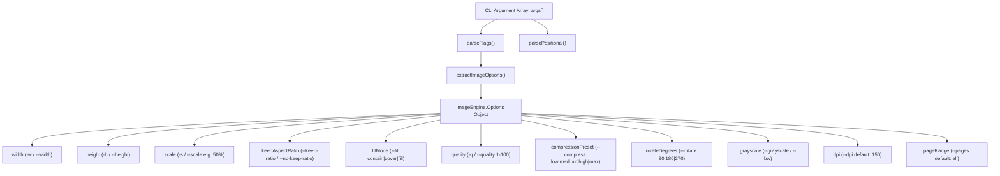
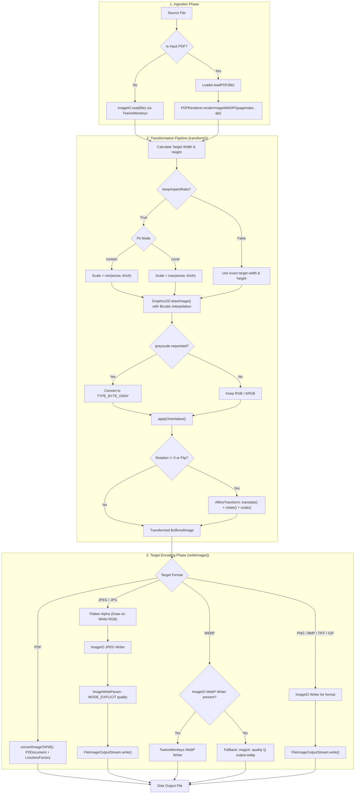
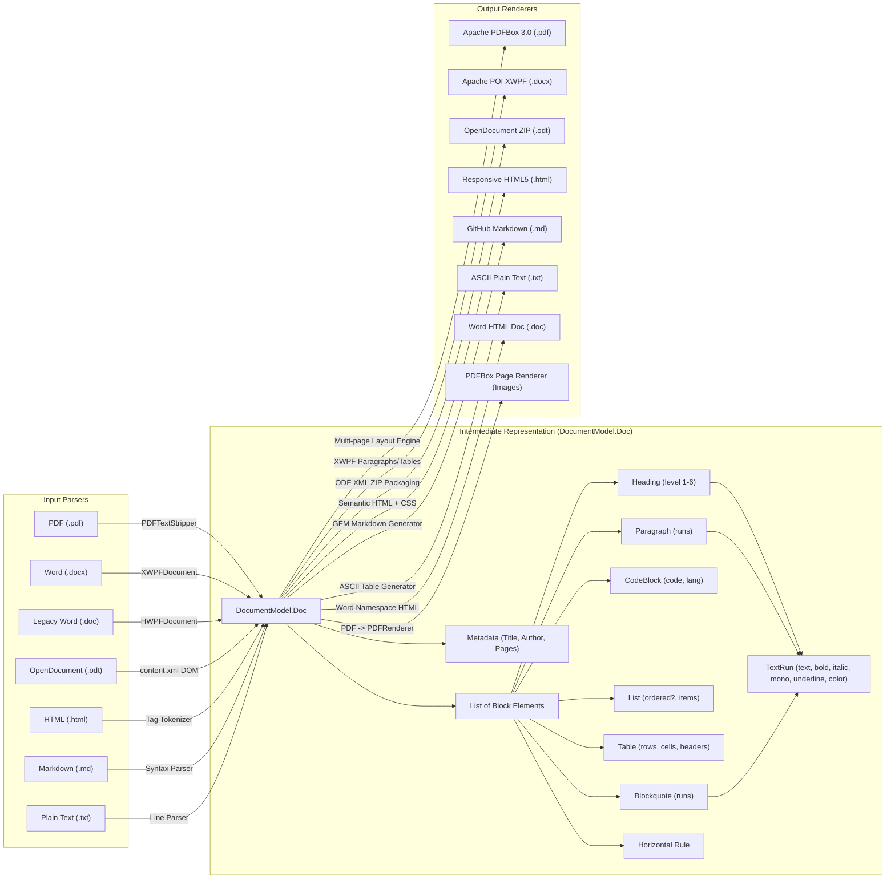
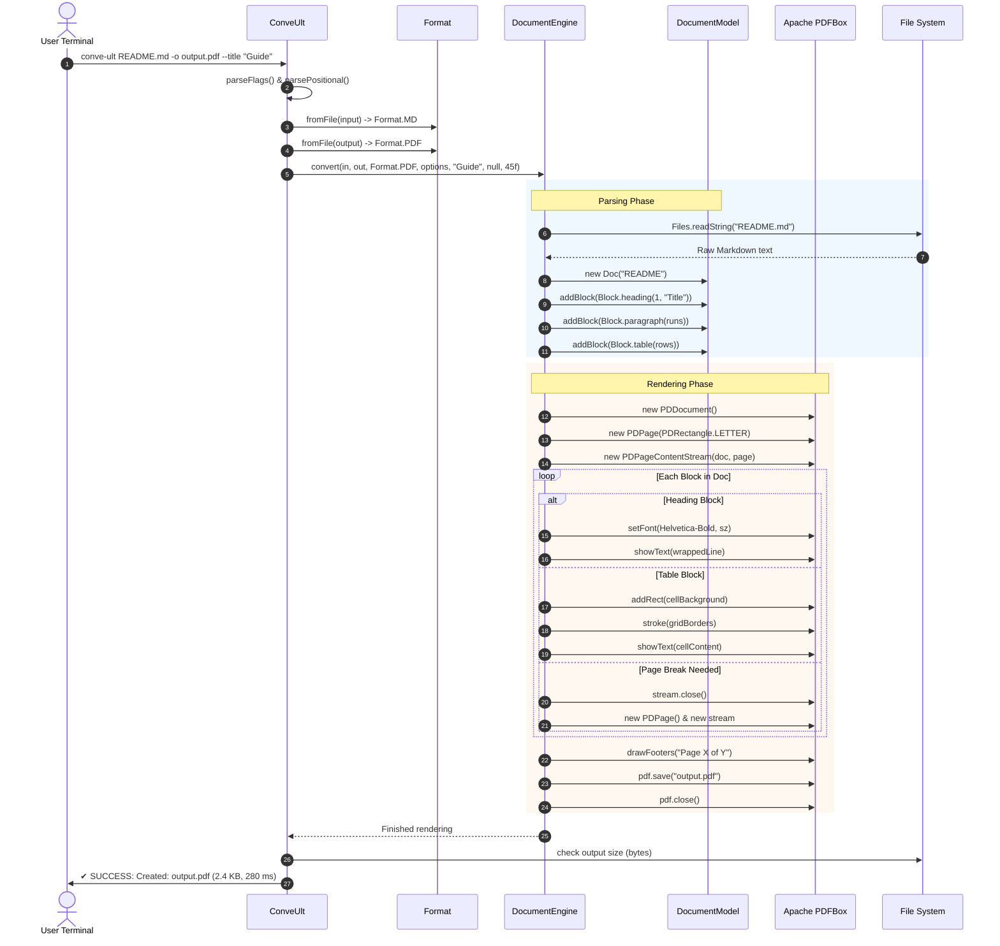
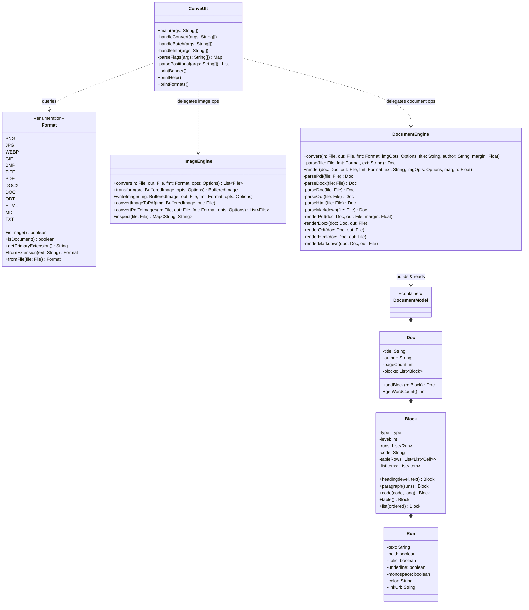

# conve-ult — Architectural Flow & Codebase Guide 🗺️
### *Complete Visual & Functional Flow of conve-ult*

---

## 📑 Contents
1. [High-Level System Architecture](#1-high-level-system-architecture)
2. [End-to-End Execution Flowchart](#2-end-to-end-execution-flowchart)
3. [Command Routing & CLI Lifecycle](#3-command-routing--cli-lifecycle)
4. [Image Pipeline Architecture & Transformation Flow](#4-image-pipeline-architecture--transformation-flow)
5. [Document Pipeline & The $N \times M$ Intermediate Model](#5-document-pipeline--the-n--m-intermediate-model)
6. [Component Interaction Sequence Diagram](#6-component-interaction-sequence-diagram)
7. [Class & Object Structure Diagram](#7-class--object-structure-diagram)
8. [Step-by-Step Code Execution Trace](#8-step-by-step-code-execution-trace)
9. [Resilience, Fallbacks & Safety Mechanics](#9-resilience-fallbacks--safety-mechanics)

---

## 1. High-Level System Architecture

`conve-ult` is designed around **zero external background daemons** and **high-cohesion modular engines**. The entire project is powered by 5 core Java source files:

```
┌────────────────────────────────────────────────────────────────────────┐
│                              ConveUlt.java                             │
│       CLI Entry Point • Argument Parsing • Subcommands • Terminal UI   │
└───────────────────┬────────────────────────────────┬───────────────────┘
                    │                                │
                    ▼                                ▼
       ┌─────────────────────────┐      ┌─────────────────────────┐
       │     ImageEngine.java    │      │   DocumentEngine.java   │
       │  Scaling • Compression  │      │  Parsing & Rendering    │
       │  Aspect Ratio • Filters │      │  POI • PDFBox • ODF XML │
       │   PDF <-> Image Bridge  │      └────────────┬────────────┘
       └────────────┬────────────┘                   │
                    │                                ▼
                    │                   ┌─────────────────────────┐
                    │                   │   DocumentModel.java    │
                    │                   │ Intermediate AST Model  │
                    │                   │ Doc • Block • Run • Cell│
                    │                   └────────────┬────────────┘
                    ▼                                │
       ┌─────────────────────────────────────────────▼───────────┐
       │                       Format.java                       │
       │     Registry of Formats, Extensions, MIME & Kind        │
       └─────────────────────────────────────────────────────────┘
```

---

## 2. End-to-End Execution Flowchart

The following diagram illustrates what happens from the millisecond the user runs `./conve-ult` in terminal until the converted file is saved and status is printed:

```mermaid
flowchart TD
    START(["User Terminal Command"]) --> WRAPPER["bin/conve-ult Wrapper Script"]
    WRAPPER --> CHECK_JAR{"target/conve-ult.jar exists?"}
    CHECK_JAR -- No --> COMPILE["Run build.sh (javac & jar)"]
    COMPILE --> LAUNCH["Invoke JVM with -Dlog4j2.statusLoggerLevel=OFF"]
    CHECK_JAR -- Yes --> LAUNCH

    LAUNCH --> ENTRY["ConveUlt.main(String[] args)"]
    ENTRY --> SILENCE["Static Block: Mute PDFBox/FontBox/Log4j Loggers"]
    SILENCE --> PARSE_ARGS["parseFlags() & parsePositional()"]

    PARSE_ARGS --> CMD_DISPATCH{"Command Mode?"}
    CMD_DISPATCH -- "--help / -h" --> HELP["printHelp() & Exit 0"]
    CMD_DISPATCH -- "--version / -V" --> VER["printVersion() & Exit 0"]
    CMD_DISPATCH -- "formats" --> FMT["printFormats() & Exit 0"]
    CMD_DISPATCH -- "info <file>" --> INFO["handleInfo() -> Inspect File Metadata"]
    CMD_DISPATCH -- "batch <dir>" --> BATCH["handleBatch() -> Iterate & Convert Folder"]
    CMD_DISPATCH -- "<input> [output]" --> CONVERT["handleConvert()"]

    CONVERT --> RESOLVE_OUT["Resolve Output Path & Target Format"]
    RESOLVE_OUT --> EXIST_CHECK{"Output Exists & no -f?"}
    EXIST_CHECK -- Yes --> WARN_EXIT["Warn and Exit 2"]
    EXIST_CHECK -- No --> OP_CHECK{"Is Image Operation?"}

    OP_CHECK -- Yes (Img->Img, Img->PDF, PDF->Img) --> IMG_FLOW["ImageEngine.convert(...)"]
    OP_CHECK -- No (Doc->Doc, Doc->Img) --> DOC_FLOW["DocumentEngine.convert(...)"]

    IMG_FLOW --> BENCHMARK["Calculate Elapsed Time & Size Delta"]
    DOC_FLOW --> BENCHMARK

    BENCHMARK --> SUCCESS["printSuccess() with Size % and Milliseconds"]
    SUCCESS --> DONE(["Process Complete (Exit 0)"])
```



---

## 3. Command Routing & CLI Lifecycle

Every CLI invocation passes through strict flag parsing and normalization:



---

## 4. Image Pipeline Architecture & Transformation Flow

The image conversion engine ([`ImageEngine.java`](file:///home/akon-s/Documents/Projects/vibecheck/conve-ult/src/main/java/com/conveult/ImageEngine.java)) processes both raster images and PDF pages:



---

## 5. Document Pipeline & The $N \times M$ Intermediate Model

The document conversion system ([`DocumentEngine.java`](file:///home/akon-s/Documents/Projects/vibecheck/conve-ult/src/main/java/com/conveult/DocumentEngine.java)) bridges arbitrary document formats through a structured Abstract Syntax Tree ([`DocumentModel.java`](file:///home/akon-s/Documents/Projects/vibecheck/conve-ult/src/main/java/com/conveult/DocumentModel.java)):



---

## 6. Component Interaction Sequence Diagram

This sequence diagram depicts the exact control flow during a document conversion (e.g., Markdown $\to$ PDF):



---

## 7. Class & Object Structure Diagram

The entire application relies on a streamlined set of cohesive classes:



---

## 8. Step-by-Step Code Execution Trace

### Example: Converting an Image to Compressed WebP
```bash
conve-ult banner.png -o banner.webp --width 1200 --quality 80
```

1. **CLI Invocation:**
   - `bin/conve-ult` calls `java -cp target/conve-ult.jar:lib/* com.conveult.ConveUlt banner.png -o banner.webp --width 1200 --quality 80`.
2. **Flag Parsing (`ConveUlt.parseFlags`):**
   - Populates `opts["output"] = "banner.webp"`, `opts["width"] = "1200"`, `opts["quality"] = "80"`.
   - `extractImageOptions()` creates `ImageEngine.Options` with `width = 1200`, `quality = 0.80f`, `keepAspectRatio = true`, `fitMode = "contain"`.
3. **Format Detection (`Format.fromFile`):**
   - `inFmt = Format.PNG` (`isImage() = true`).
   - `targetFmt = Format.WEBP` (`isImage() = true`).
4. **Image Loading (`ImageEngine.convert`):**
   - Calls `ImageIO.read(inputFile)`. TwelveMonkeys decodes PNG into `BufferedImage` (e.g. $2400 \times 1600$).
5. **Transformation (`ImageEngine.transform`):**
   - $ow = 2400$, $oh = 1600$, requested width $tw = 1200$.
   - Since `keepAspectRatio = true` and height is unconstrained: $th = 1600 \times (1200 / 2400) = 800$.
   - Allocates new `BufferedImage(1200, 800, TYPE_INT_ARGB)`.
   - `Graphics2D` scales down using `RenderingHints.VALUE_INTERPOLATION_BICUBIC`.
6. **Encoding (`ImageEngine.writeImage`):**
   - Locates WebP writer.
   - Encodes image at quality `0.80f`.
   - Writes directly to `banner.webp`.
7. **Terminal Feedback:**
   - Computes initial size vs final size, calculates savings percentage (e.g. `[Reduced by 85.3%]`), and prints:
     ```
     ✔ SUCCESS: Created: /path/to/banner.webp (28.4 KB [Reduced by 85.3%], 145 ms)
     ```

---

## 9. Resilience, Fallbacks & Safety Mechanics

| Risk / Failure Mode | Safety Mechanism in conve-ult |
| :--- | :--- |
| **Accidental File Overwrite** | Checks `output.exists()`. If true and no `-f` or `--force` flag is passed, stops immediately with exit code `2` to prevent data loss. |
| **Disguised / Misnamed `.doc` files** | Legacy `.doc` files created by third-party apps are often misnamed HTML, RTF, or ZIP/DOCX files. `DocumentEngine.parseDoc()` checks the first 8 magic bytes: `PK` delegates to `parseDocx`, `<` delegates to `parseHtml`, `{\rtf` delegates to `parseText`. |
| **Unsupported PDF Type 1 Glyphs** | Standard 14 PDF fonts use WinAnsiEncoding. Unicode emojis or characters outside 0-255 throw `IllegalArgumentException`. `DocumentEngine.sanitize()` automatically translates smart quotes, em-dashes, and bullets into compliant ASCII equivalents before PDFBox touches them. |
| **Transparency in RGB-Only Formats** | When saving transparent PNGs as JPEG or BMP (which do not support alpha channels), `ImageEngine.writeImage()` automatically flattens alpha onto a clean white background, avoiding black box artifacts. |
| **Noisy JVM / Font Logs in Terminal** | Apache PDFBox, FontBox, and Log4j StatusLogger emit warnings for missing local system fonts. `ConveUlt` silences these loggers programmatically at class-load time to ensure clean, readable CLI output. |
